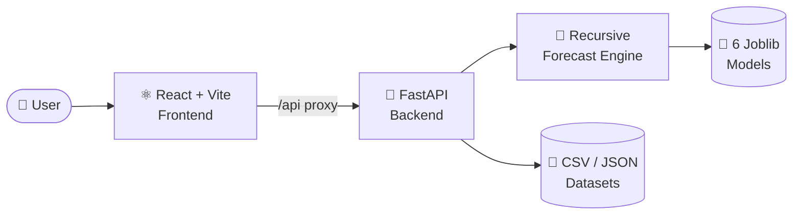
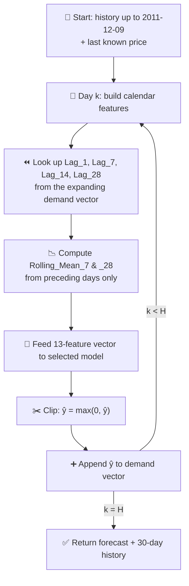

<div align="center">

# 📈 DemandIQ

### Intelligent Product Demand Forecasting & Analytics Platform

*Forecast daily retail demand with six ML models, true recursive multi-day prediction, and interactive business dashboards.*

<br/>


[Features](#-key-features) •
[Models](#-machine-learning-models--benchmark) •
[Forecasting Engine](#-recursive-multi-day-forecasting-engine) •
[Pages](#-application-pages) •
[API](#-rest-api) •
[Quick Start](#-quick-start) •
[Tech Stack](#-technology-stack)

</div>

---

## 🌟 Overview

**DemandIQ** is an enterprise-grade, responsive full-stack predictive intelligence platform that forecasts **daily product demand** across retail SKUs and delivers interactive analytics.

It uses **six pre-trained machine learning models** calibrated on the **UCI Online Retail dataset**, runs **genuine recursive multi-day autoregressive forecasting**, and surfaces rich dashboards, seasonality analyses, and CSV export tools.

<table>
<tr>
<td align="center"><h3>🛒 30</h3>High-velocity SKUs</td>
<td align="center"><h3>🧮 10,380</h3>Daily records</td>
<td align="center"><h3>🤖 6</h3>ML models</td>
<td align="center"><h3>📦 1.05M</h3>Units analysed</td>
<td align="center"><h3>💷 £1.98M</h3>Gross revenue</td>
</tr>
</table>

---

## ✨ Key Features

| | Feature | Description |
|:-:|:--|:--|
| 🔁 | **Recursive Forecasting** | Each predicted day feeds the next as a lag, with no shortcuts or flat extrapolation |
| 🤖 | **6 Model Arsenal** | CatBoost, XGBoost, Random Forest, Linear Regression, Decision Tree, KNN |
| 📊 | **Executive Dashboard** | KPIs, demand and revenue trends, and top-10 products |
| 🗓️ | **Seasonality Analysis** | Day-of-week and monthly demand profiles per SKU |
| 🏆 | **Model Leaderboard** | Side-by-side MAE, RMSE, R², and WAPE comparison |
| 📥 | **Export Hub** | Four downloadable CSV report types |
| 🌗 | **Dark / Light Theme** | Responsive SaaS UI with a drawer layout for mobile |
| ⚡ | **Zero-DB Architecture** | Joblib artifacts plus CSV/JSON, with no database overhead |

---

## 🏗️ Architecture



<details>
<summary><b>📂 Project Structure (click to expand)</b></summary>

```
DemandIQ/
├── models/                               # Saved ML model artifacts (Joblib)
│   ├── catboost.joblib                   # CatBoostRegressor (native categorical handling)
│   ├── xgboost.joblib                    # Pipeline (OneHotEncoder + Scaler + XGBRegressor)
│   ├── random_forest.joblib              # Pipeline (RandomForestRegressor)
│   ├── linear_regression.joblib          # Pipeline (LinearRegression)
│   ├── decision_tree.joblib              # Pipeline (DecisionTreeRegressor)
│   └── knn.joblib                        # Pipeline (KNeighborsRegressor)
├── data/
│   ├── demandiq_processed_data.csv       # 10,380 cleaned daily SKU records
│   ├── model_comparison.csv              # Empirical evaluation benchmark matrix
│   └── product_descriptions.json         # SKU-to-description catalog map
├── notebooks/
│   └── Product_Demand_Forecasting.ipynb  # Preprocessing, feature engineering & training
├── backend/
│   ├── main.py                           # REST routing, CORS, Pydantic validation
│   ├── forecasting.py                    # Recursive inference engine & dataset aggregator
│   └── requirements.txt                  # Python dependencies
├── frontend/
│   ├── src/
│   │   ├── components/                   # Navbar, Sidebar, StatCards, Skeletons, Error/Empty states
│   │   ├── pages/                        # Dashboard, Forecasting, Models, Products, Reports
│   │   ├── services/                     # Axios API client
│   │   ├── hooks/                        # Dark/Light theme provider
│   │   ├── layouts/                      # App shell with responsive drawer
│   │   └── App.jsx                       # React Router routing
│   ├── package.json
│   └── vite.config.js                    # Vite bundler & reverse proxy
├── Online Retail.xlsx                    # Raw UCI source dataset
├── test_integration.py                   # End-to-end integration test
└── README.md
```

</details>

---

## 🧠 Machine Learning Models & Benchmark

All six model artifacts are loaded **once at backend startup** for fast inference.

| Model | MAE ↓ | RMSE ↓ | R² ↑ | WAPE ↓ | Key Advantage |
|:--|--:|--:|--:|--:|:--|
| 🥇 **CatBoost** | **79.85** | 225.90 | 0.105 | **79.08%** | Lowest MAE & WAPE, best unit accuracy on skewed sales |
| 🥈 **XGBoost** | 83.70 | 222.96 | 0.128 | 82.89% | Second-lowest MAE, high inference speed |
| **Linear Regression** | 85.49 | 230.71 | 0.066 | 84.67% | Interpretable parametric baseline |
| 🏅 **Random Forest** | 86.07 | **221.14** | **0.142** | 85.24% | Best RMSE & R², strong outlier resilience |
| **Decision Tree** | 92.65 | 250.64 | -0.102 | 91.76% | Hierarchical single-tree rules |
| **KNN** | 94.64 | 238.12 | 0.005 | 93.72% | Instance-based nearest neighbours |
| *7-Day Naive Baseline* | *104.25* | *290.90* | *-0.485* | *103.24%* | Prior-week persistence benchmark |

> 💡 **Note on model leadership:** No single model dominates every metric. CatBoost has the lowest mean absolute error (79.85), while Random Forest has the best root mean squared error (221.14) and the highest coefficient of determination (R² = 0.142). DemandIQ highlights each model's distinct strength.

---

## 📚 Dataset

| | |
|:--|:--|
| **Source** | UCI Online Retail Dataset (Dec 2010 – Dec 2011) |
| **Scope** | 30 high-velocity products, selected by aggregate transaction demand |
| **Records** | 10,380 product-date records (346 continuous days per product) |
| **Target** | `Daily_Demand`: total units sold per product per calendar day |

**🛠️ Engineered Features (13 total)**

| Group | Features |
|:--|:--|
| 📅 Calendar | `Day`, `Month`, `DayOfWeek`, `WeekOfYear`, `IsWeekend` |
| 💷 Price | `Average_Price` (carried forward) |
| ⏪ Autoregressive Lags | `Lag_1`, `Lag_7`, `Lag_14`, `Lag_28` |
| 📉 Moving Windows | `Rolling_Mean_7`, `Rolling_Mean_28` |

---

## 🔁 Recursive Multi-Day Forecasting Engine

Instead of predicting every future day from stale history, DemandIQ performs authentic **step-by-step recursion**.



1. **State initialization:** for an `H`-day forecast on product `S` with model `M`, the engine extracts the product's continuous demand history up to `D_last = 2011-12-09` and carries forward the last known average price.
2. **Iterative step calculation:** for each future day `k ∈ [1, H]` it
   - evaluates calendar features for `D_last + k`;
   - looks up `Lag_1`, `Lag_7`, `Lag_14`, `Lag_28` from the expanding demand vector;
   - computes `Rolling_Mean_7` and `Rolling_Mean_28` from preceding days only;
   - passes the exact **13-feature vector** into the selected model;
   - clips negatives to zero (`max(0, ŷ)`);
   - appends `ŷ_k` so that days `k+1, …` build on earlier predictions.
3. **Historical context:** returns the last 30 days of actual demand alongside the predictions for a seamless chart.

---

## 🖥️ Application Pages

<details open>
<summary><b>🏠 1. Executive Dashboard</b> &nbsp;<code>/</code></summary>
<br/>

- **KPIs:** Monitored Catalog (30 SKUs), Processed Records (10,380), Historical Demand (1.05M units), Gross Revenue (£1.98M)
- **Model highlights:** CatBoost (best MAE: 79.85) and Random Forest (best RMSE: 221.14 / R²: 0.142)
- **Interactive area charts:** aggregate daily demand and revenue, filterable by 30 days, 90 days, or full year
- **Top 10 products:** ranking badges, unit volume, price, revenue, and quick-forecast buttons

</details>

<details open>
<summary><b>🔮 2. Demand Forecasting Engine</b> &nbsp;<code>/forecast</code></summary>
<br/>

- **Real-time simulation:** pick any of 30 SKUs, one of 6 models, and a 7, 14, or 30-day horizon
- **Unified chart:** 30 days of actual history, the recursive projection curve, and an origin marker
- **Metric summary:** Total Projected Demand, Average Daily Demand, Active Model, Product Info
- **Step-by-step table:** exact `Lag_1`, `Lag_7`, `Rolling_Mean_7`, and day-of-week values
- **CSV download:** one-click export of the forecast

</details>

<details open>
<summary><b>🏆 3. Model Comparison & Leaderboard</b> &nbsp;<code>/models</code></summary>
<br/>

- **Leaderboard** from `model_comparison.csv`, with highlights for MAE, RMSE, R², and WAPE
- **Metric visualizer:** horizontal bar charts comparing models on any metric
- **Export Leaderboard CSV:** full benchmark scorecard

</details>

<details open>
<summary><b>📦 4. Product Analytics & Seasonality</b> &nbsp;<code>/products</code></summary>
<br/>

- **SKU deep-dive:** searchable picker across all 30 items
- **Longitudinal charts:** daily sales with 7-day and 28-day moving averages
- **Seasonality profiles:** day-of-week (Mon–Sun) and monthly (Jan–Dec) distributions
- **Test evaluation card:** out-of-sample MAE, RMSE, and WAPE on the final 20% chronological split
- **Historical data table:** searchable, paginated, with CSV download

</details>

<details open>
<summary><b>📥 5. Reports & Export Hub</b> &nbsp;<code>/reports</code></summary>
<br/>

| # | Report |
|:-:|:--|
| 1 | Custom Multi-Day Forecast CSV Generator |
| 2 | Full ML Benchmark Comparison Scorecard CSV |
| 3 | 30-Product Catalog Master Performance Summary CSV |
| 4 | Single-Product Daily Historical Series CSV |

</details>

---

## 🔌 REST API

Interactive Swagger docs: **`http://127.0.0.1:8000/docs`**

| Method | Endpoint | Description |
|:-:|:--|:--|
|  | `/api/health` | Service health, loaded model count, and data records |
|  | `/api/dashboard` | Executive KPIs, demand/revenue trends, top 10 products |
|  | `/api/products` | Catalog of all 30 products with summary stats |
|  | `/api/products/{stock_code}` | SKU analytics, weekly/monthly seasonality, test errors |
|  | `/api/products/{stock_code}/history` | Daily demand, revenue, and rolling statistics |
|  | `/api/models` | Specs and status of all 6 ML models |
|  | `/api/model-metrics` | Leaderboard metrics (MAE, RMSE, R², WAPE) |
|  | `/api/forecast` | Runs recursive multi-day demand forecasting |

<details>
<summary><b>📤 Forecast request & response schema</b></summary>

**Request**

```json
{
  "stock_code": "20725",
  "model_name": "CatBoost",
  "horizon": 14
}
```

**Response**

```json
{
  "product_code": "20725",
  "product_description": "LUNCH BAG RED RETROSPOT",
  "selected_model": "CatBoost",
  "model_id": "catboost",
  "horizon": 14,
  "forecast_dates": ["2011-12-10", "2011-12-11", "..."],
  "predicted_demand": [0.0, 12.37, 55.22, "..."],
  "total_predicted_demand": 586.2,
  "average_predicted_demand": 41.87,
  "detailed_forecast": [
    {
      "date": "2011-12-10",
      "day_name": "Saturday",
      "day_of_week": 5,
      "predicted_demand": 0.0,
      "lag_1": 0.0,
      "lag_7": 0.0,
      "rolling_mean_7": 1.57,
      "rolling_mean_28": 26.11,
      "is_weekend": 1
    }
  ],
  "historical_context": [
    { "date": "2011-11-10", "actual_demand": 45.0 }
  ]
}
```

</details>

---

## 🚀 Quick Start

### ✅ Prerequisites

- 🐍 **Python 3.10+** (3.11 recommended)
- 🟢 **Node.js 18+** and **npm 9+**

### 1️⃣ Backend

```bash
# Go to the project root
cd "DemandIQ – Intelligent Product Demand Forecasting & Analytics Platform"

# (Optional) create and activate a virtual environment
python -m venv venv
.\venv\Scripts\activate        # Windows
source venv/bin/activate       # macOS / Linux

# Install dependencies
pip install -r backend/requirements.txt

# Start the FastAPI server
python -m uvicorn main:app --app-dir backend --host 127.0.0.1 --port 8000 --reload
```

> 🌐 API: `http://127.0.0.1:8000`  |  📖 Docs: `http://127.0.0.1:8000/docs`

### 2️⃣ Frontend

Open a **new terminal**:

```bash
cd frontend
npm install
npm run dev
```

> 🎉 App: **`http://127.0.0.1:5173`**
> The Vite dev server automatically proxies all `/api` requests to `http://127.0.0.1:8000`.

### 3️⃣ Run Integration Tests

Verify the frontend proxy, the FastAPI backend, and all six ML models end to end:

```bash
python test_integration.py
```

<details>
<summary><b>✅ Expected output</b></summary>

```
Testing Backend directly:
GET /api/health -> 200 {"status":"healthy", "models_count":6, ...}
POST /api/forecast (CatBoost) -> 200 Total predicted: ...

Testing Vite frontend server:
GET http://127.0.0.1:5173/ -> 200 HTML length: ...

Testing Vite Proxy to Backend:
GET http://127.0.0.1:5173/api/health -> 200 ...

Testing all 6 models via Vite proxy:
Model CatBoost: 200 OK
Model XGBoost: 200 OK
Model Random Forest: 200 OK
Model Linear Regression: 200 OK
Model Decision Tree: 200 OK
Model KNN: 200 OK

ALL SERVER INTEGRATION TESTS COMPLETED SUCCESSFULLY!
```

</details>

---

## 🧰 Technology Stack

| Layer | Technologies |
|:--|:--|
| 🎨 **Frontend** | React 19 · Vite · Tailwind CSS v4 · Recharts · Lucide React · Axios · React Router v7 |
| ⚙️ **Backend** | Python 3.11 · FastAPI · Uvicorn · Pydantic v2 |
| 🤖 **ML & Data** | Scikit-learn · XGBoost · CatBoost · Joblib · Pandas · NumPy · OpenPyXL |
| 💾 **Storage** | Joblib pipelines · CSV · JSON (zero SQL/NoSQL overhead) |

---

<div align="center">

### ⭐ If you find DemandIQ useful, consider giving it a star!

Built with ❤️ for smarter retail demand planning.

</div>
